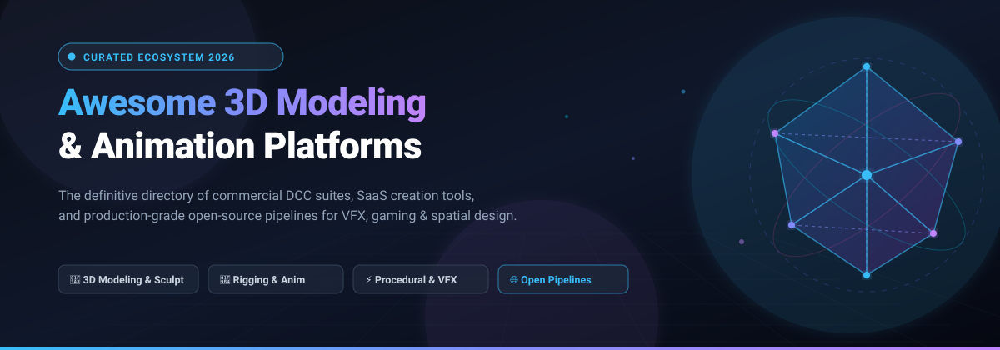

<div align="center">



# Awesome 3D Modeling & Animation

[](https://awesome.re)
[](https://opensource.org/licenses/MIT)
[](https://github.com/ishandutta2007/Awesome-3D-Modeling-Animation/pulls)
[](https://github.com/ishandutta2007/Awesome-3D-Modeling-Animation/pulse)
[](https://github.com/ishandutta2007/Awesome-3D-Modeling-Animation/stargazers)

**A curated, production-oriented directory of commercial DCC platforms, SaaS creation suites, and top open-source repositories for 3D modeling, sculpting, character rigging, procedural VFX, real-time animation, and computer graphics pipelines.**

*Updated regularly for artists, game developers, VFX technical directors, CAD engineers, and 3D indie creators.*

---

[Sector Overview](#sector-overview--market-dynamics) • [SaaS & Commercial Platforms](#saas--commercial-platforms) • [Open-Source Ecosystem](#open-source-github-projects) • [Pipeline Integration](#pipeline-integration--architecture) • [FAQ](#frequently-asked-questions-faq) • [Contributing](#how-to-contribute)

---

</div>

## Table of Contents

- [Sector Overview & Market Dynamics](#sector-overview--market-dynamics)
- [SaaS & Commercial Platforms](#saas--commercial-platforms)
- [Open-Source GitHub Projects](#open-source-github-projects)
  - [Top Open-Source 3D Repositories (Ranked by Stars)](#top-open-source-3d-repositories-ranked-by-stars)
  - [Core Pipeline Interchange & Standards](#core-pipeline-interchange--standards)
- [Pipeline Integration & Architecture](#pipeline-integration--architecture)
- [Frequently Asked Questions (FAQ)](#frequently-asked-questions-faq)
- [How to Contribute](#how-to-contribute)
- [License & Disclaimer](#license--disclaimer)

---

## Sector Overview & Market Dynamics

The global 3D modeling, computer graphics, and animation software market is valued at approximately **$29.4 Billion to $32.6 Billion in 2026** and is projected to expand beyond **$52 Billion by 2030** (CAGR of ~11.8%), propelled by real-time virtual production, next-gen gaming engines, digital twins in engineering/architecture, spatial computing (XR/AR), and generative AI 3D asset workflows.

From a market structure perspective, the industry exhibits a **moderately concentrated, bifurcated ecosystem**:
- **High-End Studio Tier (Concentrated Oligopoly):** Enterprise film, television, and AAA game production pipelines remain dominated by entrenched legacy giants—chiefly Autodesk (`Maya`, `3ds Max`), Adobe (`Substance 3D`), and Maxon/Nemetschek (`Cinema 4D`, `ZBrush`). These vendors benefit from deep proprietary plugin ecosystems, decades of legacy pipeline scripts (Python/MEL/C++ APIs), and studio site-license agreements.
- **Indie, Web & Open-Source Tier (Rapidly Democratizing & Fragmented):** Driven by the meteoric maturation of `Blender`, real-time procedural tools like SideFX `Houdini`, browser-native SaaS modelers (`Spline`, `Vectary`), and open interchange standards (`Universal Scene Description / OpenUSD` and `glTF`), the barriers to high-fidelity 3D asset creation and procedural simulation have collapsed, empowering indie studios, spatial developers, and solo creators worldwide.

---

## SaaS & Commercial Platforms

The table below lists the premier commercial Digital Content Creation (DCC) and hosted SaaS platforms, sorted in descending order by parent company size (market capitalization or private enterprise valuation).

| Platform / Product | Company & Size (Revenue / Valuation) | Primary Focus & Capabilities | Starting Pricing | Free Tier / Trial Limits |
| :--- | :--- | :--- | :--- | :--- |
| **[Substance 3D](https://www.adobe.com/products/substance3d.html)** | **Adobe Inc.**<br>Market Cap: ~$225B+<br>(Annual Revenue: ~$21.4B) | PBR material authoring, 3D texturing, procedural pattern design (Painter, Designer, Sampler, Stager). | **$19.99/mo** (Texturing plan billed annually) or **$49.99/mo** (Collection plan billed annually) | **30-day free trial** with full access to Painter, Designer, Sampler, and 30 downloadable 3D assets/mo during the trial period. |
| **[Autodesk Maya](https://www.autodesk.com/products/maya/overview)** | **Autodesk, Inc.**<br>Market Cap: ~$62B+<br>(Annual Revenue: ~$5.8B) | Film & AAA game industry-standard 3D animation, character rigging, simulation (Bifrost), and advanced poly modeling. | **$235/mo** (monthly) or **$1,875/yr** (Maya Indie available at **$305/yr** for artists under $100k revenue) | **30-day free trial** with full production capabilities and local rendering; renewable 1-year free educational license for verified students & educators. |
| **[Autodesk 3ds Max](https://www.autodesk.com/products/3ds-max/overview)** | **Autodesk, Inc.**<br>Market Cap: ~$62B+<br>(Annual Revenue: ~$5.8B) | Architectural visualization, game environment design, procedural modeling, and rapid 3D asset layout with Arnold integration. | **$235/mo** (monthly) or **$1,875/yr** (3ds Max Indie available at **$305/yr** for eligible creators) | **30-day free trial** with full access to modeling toolsets and Arnold GPU/CPU renderer; 1-year renewable free educational plan for qualified academic users. |
| **[Modo](https://www.foundry.com/products/modo)** | **Foundry / Roper Technologies**<br>Parent Market Cap: ~$58B+<br>(Foundry Valuation: ~$700M; Rev: ~$90M) | Direct subdivision surface mesh modeling, rapid concept sculpting, UV packing, and look development. | **$71/mo** (annual subscription at $829/yr) or **$169** billed quarterly | **30-day free trial** with unrestricted modeling, UV mapping, rendering, and sculpting feature set for individual evaluation. |
| **[SideFX Houdini](https://www.sidefx.com/products/houdini/)** | **SideFX / Epic Games**<br>Epic Valuation: ~$32B+<br>(Epic Revenue: ~$5.6B) | Node-based procedural generation, complex dynamic simulations (fluids, smoke, pyro, crowds, destruction), and technical VFX. | **$269/yr** (Houdini Indie for studios & freelancers under $100k gross revenue) or **$1,995** perpetual license | **Forever-free Houdini Apprentice tier** with non-commercial license, render resolution capped at 1280x720, watermark on renders, and `.hipnc` file format. |
| **[SketchUp Pro](https://www.sketchup.com/)** | **Trimble Inc.**<br>Market Cap: ~$17.5B+<br>(Annual Revenue: ~$3.8B) | Intuitive push-pull 3D modeling for architecture, interior space planning, landscape design, and 3D construction documentation. | **$119/yr** (SketchUp Go) or **$349/yr** (SketchUp Pro desktop subscription) | **Forever-free SketchUp Free tier** (web-based 3D modeling, 10 GB Trimble Connect cloud storage, standard 3D Warehouse access, export limited to STL/PNG); plus a **30-day free trial** of SketchUp Pro desktop. |
| **[Cinema 4D](https://www.maxon.net/en/cinema-4d)** | **Maxon / Nemetschek Group**<br>Nemetschek Market Cap: ~$12.5B+<br>(Maxon Division Rev: ~$160M) | Motion graphics (MoGraph toolset), intuitive procedural animation, broadcast design, and integrated Redshift GPU rendering. | **$59.91/mo** (billed annually at $719/yr) or **$99/mo** billed monthly (or Maxon One bundle at $149/mo) | **14-day free trial** with full access to Cinema 4D, Redshift rendering, simulation cloth/ropes, and MoGraph toolsets via MyMaxon account. |
| **[ZBrush](https://www.maxon.net/en/zbrush)** | **Maxon / Nemetschek Group**<br>Nemetschek Market Cap: ~$12.5B+<br>(Maxon Division Rev: ~$160M) | High-resolution digital sculpting, character/creature concept art, Dynamesh dyn-topology, and billions of polygon details. | **$29.91/mo** (billed annually at $359/yr) or **$39/mo** billed monthly | **14-day free trial** with complete sculpting brushes, ZRemesher retopology, dynamic tessellation, and 3D mesh export capabilities enabled. |
| **[Spline 3D](https://spline.design/)** | **Spline Inc.**<br>Private Valuation: ~$200M<br>(Raised $16M VC) | Browser-first collaborative 3D design, interactive web animations, real-time physics, and direct React/Three.js code export. | **$9/mo** (Super tier billed annually at $108/yr) or **$12/mo** billed monthly | **Forever-free Basic tier** with unlimited personal files, 1 personal team file, public web embeds (includes Spline watermark), and access to 3D asset libraries. |
| **[Vectary](https://www.vectary.com/)** | **Vectary Inc.**<br>Private Valuation: ~$35M<br>(Raised $10M+ VC) | Cloud-based collaborative 3D studio, augmented reality (AR) web viewer, real-time configurators, and no-code 3D embed platform. | **$19/mo** (Pro tier billed annually at $228/yr) or **$25/mo** billed monthly | **Forever-free Starter tier** with up to 10 active projects, 1,000 monthly interactive web views, standard AR preview, and public sharing. |
| **[LightWave 3D](https://www.lightwave3d.com/)** | **LightWave Digital**<br>Private / SME Valuation: ~$15M<br>(Annual Revenue: ~$2M) | Split Modeler and Layout 3D production suite for broadcast graphics, independent film, and product visualization. | **$795 perpetual license** (standalone license; maintenance/upgrades from $395) | **30-day free trial** fully functional with modeler, layout, rendering, and export options enabled without watermark restrictions. |
| **[Blender Studio](https://studio.blender.org/)** | **Blender Institute**<br>Annual Ops Budget: ~$4M<br>(Non-Profit Open Foundation) | Cloud collaboration, production asset libraries, open-movie production pipelines, and masterclass animation training. | **€11.50/mo (~$12.50/mo)** or **€115/yr (~$125/yr)** subscription membership | **Forever-free Community tier** with open access to software source, documentation, community showcases; core Blender DCC software is 100% free and open forever. |

---

## Open-Source GitHub Projects

The open-source 3D graphics community provides enterprise-grade suites, geometry processing libraries, and production data structures.

### Top Open-Source 3D Repositories (Ranked by Stars)

Each repository includes an active GitHub star badge linking directly to its stargazers page, ordered in descending order of star count.

1. **[FreeCAD](https://github.com/FreeCAD/FreeCAD)** [](https://github.com/FreeCAD/FreeCAD/stargazers)  
   *A multiplatform, open-source parametric 3D CAD modeler primarily designed for mechanical engineering, product design, and architectural BIM.*  
   *Features modular workbenches (PartDesign, Sketcher, FEM, CAM) and a deep Python scripting API.*

2. **[3D Gaussian Splatting](https://github.com/graphdeco-inria/gaussian-splatting)** [](https://github.com/graphdeco-inria/gaussian-splatting/stargazers)  
   *The groundbreaking reference implementation for real-time radiance field rendering, converting photographic datasets into differentiable 3D ellipsoidal splats for photorealistic scene navigation.*

3. **[Blender](https://github.com/blender/blender)** [](https://github.com/blender/blender/stargazers)  
   *The flagship all-in-one free and open-source 3D creation suite. Encompasses polygon/subdivision modeling, sculpting, character rigging, animation, Geometry Nodes (procedural generation), physics simulation, compositing, and Cycles/EEVEE render engines.*

4. **[Open3D](https://github.com/isl-org/Open3D)** [](https://github.com/isl-org/Open3D/stargazers)  
   *A modern, high-performance C++ and Python library for 3D data processing, point cloud alignment, surface reconstruction, mesh filtering, and GPU-accelerated visualization.*

5. **[Assimp (Open Asset Import Library)](https://github.com/assimp/assimp)** [](https://github.com/assimp/assimp/stargazers)  
   *Universal 3D model import and export library supporting over 40+ asset formats (FBX, OBJ, glTF, Collada, 3DS, STL) with automated post-processing routines (tangent generation, triangulation, normal smoothing).*

6. **[Meshroom / AliceVision](https://github.com/alicevision/Meshroom)** [](https://github.com/alicevision/Meshroom/stargazers)  
   *Open-source 3D photogrammetry and computer vision pipeline. Transforms collections of photographs into dense, textured 3D geometric meshes using node-based workflows.*

7. **[Nerfstudio](https://github.com/nerfstudio-project/nerfstudio)** [](https://github.com/nerfstudio-project/nerfstudio/stargazers)  
   *A modular framework for neural radiance field (NeRF) research and production-grade 3D capture, camera trajectory animation, and real-time scene export.*

8. **[OpenSCAD](https://github.com/openscad/openscad)** [](https://github.com/openscad/openscad/stargazers)  
   *The programmers' solid 3D CAD modeler. Uses a dedicated declarative code-based modeling language to compile constructive solid geometry (CSG) into clean STL/3D printable meshes.*

9. **[PrusaSlicer](https://github.com/prusa3d/PrusaSlicer)** [](https://github.com/prusa3d/PrusaSlicer/stargazers)  
   *Powerful open-source 3D mesh slicing, support structure generation, planar polygon offsetting, and geometric mesh manipulation engine.*

10. **[glTF Reference & Tooling](https://github.com/KhronosGroup/glTF)** [](https://github.com/KhronosGroup/glTF/stargazers)  
    *The Khronos Group specification and validator ecosystem for the "JPEG of 3D" — an efficient, interoperable runtime format for 3D scenes, PBR materials, skeletal animations, and morph targets.*

11. **[Pixar OpenUSD (Universal Scene Description)](https://github.com/PixarAnimationStudios/OpenUSD)** [](https://github.com/PixarAnimationStudios/OpenUSD/stargazers)  
    *The foundational high-performance 3D scene description technology for Hollywood animation, VFX, and metaverse ecosystems, enabling collaborative non-destructive asset layering and composition.*

12. **[Instant Meshes](https://github.com/wjakob/instant-meshes)** [](https://github.com/wjakob/instant-meshes/stargazers)  
    *Interactive field-aligned remeshing algorithm that converts dense unstructured triangles into clean, animation-friendly quad-dominant surface topologies in real time.*

13. **[MeshLab](https://github.com/cnr-isti-vclab/meshlab)** [](https://github.com/cnr-isti-vclab/meshlab/stargazers)  
    *General-purpose 3D triangular mesh processing suite specialized in cleaning raw 3D scan data, decimation, Poisson reconstruction, hole filling, and geometric analysis.*

14. **[libigl](https://github.com/libigl/libigl)** [](https://github.com/libigl/libigl/stargazers)  
    *Header-only C++ geometry processing library providing clean functions for harmonic coordinates, mesh deformation, geodesic distances, parameterization, and curvature estimation.*

15. **[Dust3D](https://github.com/huxingyi/dust3d)** [](https://github.com/huxingyi/dust3d/stargazers)  
    *Quick 3D modeler engineered for rapid game asset prototyping with instant auto-rigging, automated UV unwrapping, and direct game engine export.*

16. **[OpenVDB](https://github.com/AcademySoftwareFoundation/openvdb)** [](https://github.com/AcademySoftwareFoundation/openvdb/stargazers)  
    *Academy Award-winning hierarchical data structure and suite of tools for efficient storage and manipulation of volumetric data, gas/fire/fluid simulations, and level sets.*

17. **[Armory3D](https://github.com/armory3d/armory)** [](https://github.com/armory3d/armory/stargazers)  
    *Open-source 3D game engine directly integrated inside Blender, allowing real-time interactive rendering, procedural logic nodes, and multiplatform deployment.*

18. **[MakeHuman](https://github.com/makehumancommunity/makehuman)** [](https://github.com/makehumancommunity/makehuman/stargazers)  
    *Open-source parametric humanoid 3D generator featuring sliders for age, weight, gender, muscle tone, facial topography, and automated skeletal rig presets for animation.*

19. **[Alembic](https://github.com/alembic/alembic)** [](https://github.com/alembic/alembic/stargazers)  
    *Open computer graphics interchange framework that distills complex animated scenes, baked deformation caches, and simulation data into non-procedural baked representations.*

20. **[Wings 3D](https://github.com/dgud/wings)** [](https://github.com/dgud/wings/stargazers)  
    *Dedicated subdivision surface modeler built with Erlang, prioritizing clean polygonal mesh construction through a context-sensitive right-click workflow.*

---

## Pipeline Integration & Architecture

Modern visual production pipelines unify specialized tools through open standards rather than relying on a single monolithic package:

```
[ Concept / Photogrammetry / Generative 3D ]
          │ (Meshroom / Nerfstudio / Open3D)
          ▼
[ Base Mesh & Hard-Surface Modeling ]
          │ (Blender / FreeCAD / Wings 3D / Maya)
          ▼
[ High-Frequency Sculpting & Retopology ]
          │ (ZBrush / Blender Sculpt / Instant Meshes)
          ▼
[ UV Unwrapping & PBR Texturing ]
          │ (Adobe Substance 3D / Blender)
          ▼
[ Rigging, Keyframing & Simulation ]
          │ (Maya / Blender / Houdini / OpenVDB)
          ▼
[ Interchange & Scene Composition ]
          │ (Pixar OpenUSD / Alembic / glTF)
          ▼
[ Rendering & Real-Time Engine ]
          │ (Cycles / Arnold / Redshift / Unreal / Godot)
```

- **OpenUSD (`.usd`, `.usdc`, `.usda`):** Non-destructive multi-department pipeline assembly where modeling, shading, animation, and lighting reside in composited layers.
- **glTF 2.0 (`.gltf`, `.glb`):** The standard for web, mobile AR/VR, and game engines, containing geometry, PBR materials, skinning, and animations in compact binary form.
- **Alembic (`.abc`):** High-throughput baked cache format for complex dynamic simulations, hair geometry, and character deformations across DCC software.

---

## Frequently Asked Questions (FAQ)

### Which 3D modeling tool is best for beginners?
**Blender** is the top recommendation for beginners because it is 100% free, fully featured (modeling, sculpting, animation, VFX, rendering), and possesses the largest global community with tens of thousands of free tutorials. For browser-based web designers, **Spline 3D** offers an extremely gentle learning curve for 3D web illustrations.

### What is the difference between Autodesk Maya, 3ds Max, and Cinema 4D?
- **Maya:** The dominant choice for character animation, complex skeletal rigging, and high-end visual effects pipelines in Hollywood and AAA games.
- **3ds Max:** Exceptional at architectural visualization (ArchViz), parametric modeling plugins, and game environment construction.
- **Cinema 4D:** The undisputed industry leader in motion graphics, broadcast animation, and fast kinetic typography via its MoGraph toolset.

### How does SideFX Houdini differ from traditional modelers?
Unlike traditional polygonal modelers that store vertex indices directly, Houdini is **procedural and node-based**. Every modeling or simulation operation is a non-destructive node in a dependency graph. If you change a parameter upstream, the entire downstream 3D mesh, UVs, and dynamic simulation automatically recalculate.

### Can Blender replace commercial software in a professional production studio?
Yes. Award-winning animation studios, game developers, and VFX boutiques actively employ Blender in production. While commercial tools (Maya for legacy pipeline integration, ZBrush for 100-million polygon sculpting, and Substance 3D for texturing) remain entrenched in large enterprise studios, Blender handles entire production pipelines from scratch with zero licensing fees.

---

## How to Contribute

Contributions are welcome! Please follow these steps to add new platforms or open-source repositories:

1. **Fork this repository**.
2. **Add or edit entries in [README.md](file:///C:/Users/ishan/Documents/Projects/Awesome-3D-Modeling-Animation/README.md)**:
   - For **SaaS/Commercial platforms**: Add to the table with exact company size (market cap/valuation), specific starting price, and exact free tier/trial limits.
   - For **Open-source projects**: Ensure it has an active GitHub repo, add the `style=social&color=white` star badge linking to `/stargazers`, and maintain descending star count order.
3. **Submit a Pull Request** with a concise description of the addition.

---

## License & Disclaimer

- Distributed under the [MIT License](https://opensource.org/licenses/MIT).
- *Disclaimer: Product names, logos, and brands are property of their respective owners. Inclusion in this curated list does not imply endorsement.*
